# Andromon Companion user guide (phone app)

Andromon Companion is the phone side of [Andromon](https://github.com/Deshan555/Andromon_PC). It does two jobs:

1. **It links the phone to Andromon on your computer**, so the computer can show your messages, contacts, call log, calendar, notifications, photos and music.
2. **It has phone-care tools you use on the phone itself**: memory, cleaner, battery, freezer, network tests, storage, permissions and a hardware test.
3. **It shows statistics about apps**: screen time, data, battery and storage per app, and what the link to the computer did.

This guide shows every screen and explains what each option does. The PC app has its own guide: [Andromon user guide](https://github.com/Deshan555/Andromon_PC/blob/main/docs/USER_GUIDE.md).

The screenshots were taken on an Android 12 emulator with made-up sample data.

## Contents

1. [How the phone app works with the computer](#1-how-the-phone-app-works-with-the-computer)
2. [Getting the app](#2-getting-the-app)
3. [Finding your way around](#3-finding-your-way-around)
4. [PC link](#4-pc-link)
5. [Tools](#5-tools)
6. [Cleaner](#6-cleaner)
7. [Network](#7-network)
8. [Transfer: receive and send (Wi‑Fi)](#8-transfer-receive-and-send-wi-fi)
9. [Memory](#9-memory)
10. [Battery](#10-battery)
11. [Battery saver](#11-battery-saver)
12. [Freezer](#12-freezer)
13. [Apps](#13-apps)
14. [Storage](#14-storage)
15. [Permissions](#15-permissions)
16. [Hardware test](#16-hardware-test)
17. [Settings](#17-settings)
18. [Privileged access (Shizuku, helper, root)](#18-privileged-access-shizuku-helper-root)
19. [Notification buttons and quick-settings tiles](#19-notification-buttons-and-quick-settings-tiles)
20. [Privacy](#20-privacy)
21. [Stats](#21-stats)

---

## 1. How the phone app works with the computer

```
 Computer (Andromon)          USB cable or Wireless debugging          Phone
 ─────────────────────          ───────────────────────────────          ─────
 "Show me the messages"  ─────────────────────────────────────►  Companion checks the request
                                                                 really comes from adb,
 list of messages        ◄─────────────────────────────────────  reads them and answers
```

- Android only lets **apps on the phone** read SMS, contacts, the call log, the calendar and notifications. The companion is that app: Andromon asks, the companion reads and answers.
- Requests arrive through **adb**, Android's debugging link (USB cable, or Wireless debugging on Android 11+). The companion checks that each request comes from adb. Other apps on the phone, and other devices on the network, can't talk to it.
- While the link is on, a **"Connected to Andromon"** notification is shown. The link stops when you press **Stop** on it or on the PC link screen, or after 15 idle minutes.
- The phone-care tools work on their own, without a computer. A few of them can do more with **privileged access** (see [section 18](#18-privileged-access-shizuku-helper-root)).

## 2. Getting the app

You don't install it yourself. Connect the phone to Andromon with the USB cable and open **Messages**, **Contacts**, **Call log**, **Photos** or **Music** there; Andromon offers **Install companion** and does the rest, including the permissions. Installing this way matters: Android refuses the SMS and call-log permissions for apps installed by tapping an APK file.

## 3. Finding your way around

- The **dark bar at the bottom** has five buttons, each with its name: **PC link, Transfer, Tools, Stats, Settings**. The open one's icon sits on a white pill. The app opens on **PC link**.
- Tapping the button of the screen you are on scrolls it back to the top (in Settings, it also goes back to the list of pages).
- Every tool (**Memory, Cleaner, Network, Battery, Battery saver, Freezer, Apps, Storage, F-Droid, Recover, Permissions, Hardware**) opens from a tile on **Tools**. While one is open, **Tools** is highlighted in the bar.
- Android's **Back** gesture returns to where you came from: from a tool to Tools (or to Stats, when you opened an app from Stats), and from the other bar screens to PC link. From PC link, Back leaves the app.
- Each screen has one green card at the top with the most important figure, and lighter cards below with details and options.
- The round button at the top right of a screen refreshes it or opens its main action.

## 4. PC link

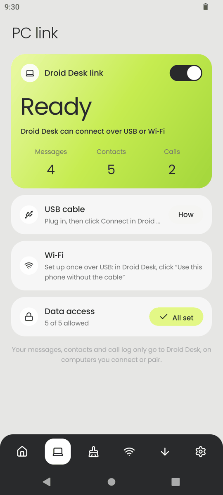

The screen the app opens on: the link to Andromon on your computer.

| Part | What it does |
|---|---|
| **Green card** | **Linked** (a computer is talking to the phone), **Ready** (the link is on and waiting) or **Off**. When linked, it shows the computer's name, whether it is connected over USB or Wi‑Fi, and for how long. Until Andromon has said its name, it says "Your computer". **Start / Stop** switches the link on or off. Andromon can also start it itself over USB. |
| **Quick actions** | **Send files** picks files and opens Transfer › Send. **Send clipboard** sends what is copied on the phone to the computer (or, when no computer is listening on the link, puts it in Transfer › Send to go over Wi‑Fi). **Receive files** opens Transfer › Receive. **Scan code** scans the code Andromon's Wi‑Fi transfer page shows. **Connect over Wi‑Fi** jumps to the Wi‑Fi card below. |
| **Today** | Time linked, requests from the computer and files moved today. **PC link stats** opens Stats › PC link. |
| **Recent activity** | What the computer did lately ("Read your messages", "Sent 3 files to Studio Mac"), newest first; repeats are counted instead of listed again. **See all** shows the last 40. |
| **What the computer can read** | How many messages, contacts and calls Andromon can see, and each data permission. **Allow** asks for the missing ones. If you refused one with "Don't ask again", Android won't ask any more: the row and the button then say **App info**, which opens the page where you can allow it. |
| **USB cable** | **How** unfolds the four steps: a cable that carries data, USB debugging on, click Connect in Andromon, tap Allow. |
| **Wi‑Fi** | After the one-time setup in Andromon (**Use this phone without the cable**), a single button turns the Wi‑Fi connection on and off. Before the setup it lists the steps (also for pairing by hand in Wireless debugging). If Developer options are off, it says how to turn them on (Settings › About phone › tap Build number seven times), with a button to About phone. Needs Android 11 or newer. |

Turn the Wi‑Fi connection off when you are done; it also switches itself off when the phone leaves the Wi‑Fi network or restarts. The activity list and the figures stay on the phone for 30 days; **Settings › PC link › Clear link history** removes them.

## 5. Tools

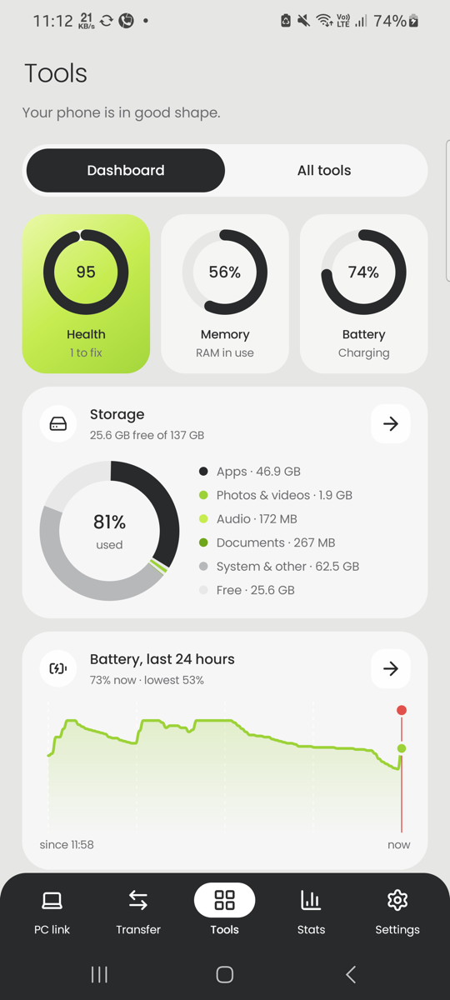

- The line under **Tools** sums up the phone's state ("Your phone is in great shape"). It comes from free storage, free memory and battery condition. When something costs points, it is listed on the green card with a link to the screen that helps.
- The **green card** shows one fact at a time (health, storage, memory, battery, uptime, network, installed apps, screen, Android version); tap it for the next. The arrow at its top right opens the screen that says more, when there is one.
- **Storage** shows what apps, media and documents use, and how much is free. The arrow opens the Storage screen (folder sizes); **Free up space with the Cleaner** opens the Cleaner.
- Each **tile** opens a tool and shows its current state (for example "46% of RAM in use").

## 6. Cleaner

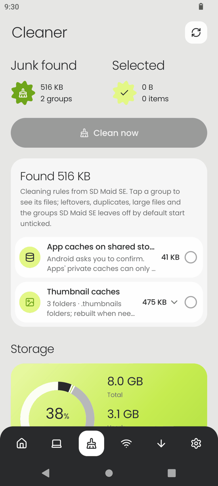

Finds files that can be deleted safely.

- The screen scans when it opens; the refresh button scans again.
- **Junk found** lists groups: app caches on shared storage, thumbnail caches, log and temp files, empty folders, leftovers of uninstalled apps, installers (APKs) you no longer need, old screenshots, duplicates and large files.
- Tap a group to see its files. Tick the groups (or single files) you want gone. Groups that could hold something you want (leftovers, duplicates, large files) start **unticked**.
- **Clean now** deletes what is ticked, after asking once more.
- **Storage** at the bottom shows how full the phone and each SD card are.

Good to know: apps' private caches, usually the largest part, can't be cleared by any app. Andromon on the computer can do it (**Apps › Clear app caches**). Which rules run is set under **Settings › Cleaning rules**, and the size that counts as a "large file" under **Settings › Large files**.

## 7. Network

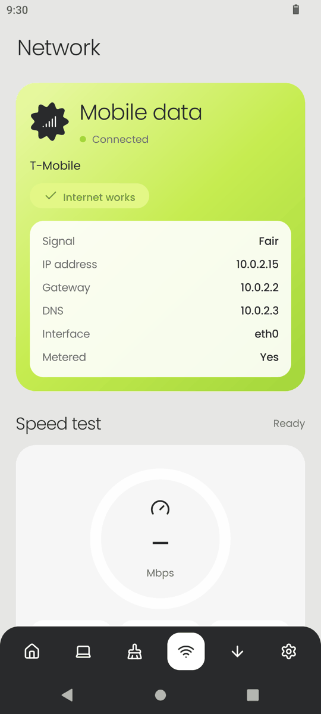

- The **green card** shows the connection (Wi‑Fi or mobile data), whether the internet works, signal, IP address, gateway, DNS and whether the connection is metered.
- **Speed test** measures ping, download and upload. It uses up to about 125 MB on Wi‑Fi and 35 MB on mobile data. **Settings › Save data on speed tests** always runs the shorter test.
- **Ping** checks how fast a host answers; **DNS lookup** shows the addresses behind a name.

## 8. Transfer: receive and send (Wi‑Fi)

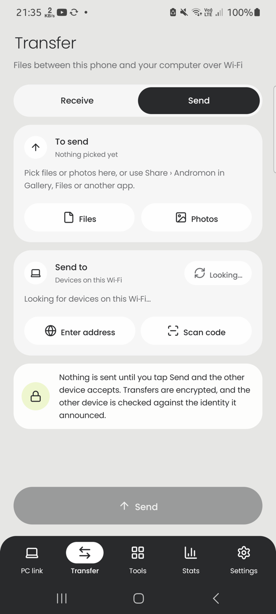

Moves files between the phone and a computer over Wi‑Fi, without a cable. The switch at the top chooses **Receive** or **Send**; Transfer opens on the side you used last.

### Receive

| Option | What it does |
|---|---|
| **Turn on receiving** | Makes the phone visible to computers on the same Wi‑Fi. Nothing listens on the network while it is off. It turns itself off after 30 minutes without transfers. |
| **Saved to** | Received files go to `Download/Andromon`. |
| **Direct link** | Lets the computer join a private Wi‑Fi the phone opens just for the transfer. Faster for big files than going through the router. |
| **Received** | The files you received; tap one to open it. **Downloads** opens the folder. |

Every transfer asks first: **Accept** or **Decline**, on the screen or in the notification. Nothing is saved without your consent.

### Send

- Pick **Files** or **Photos**, or use **Share › Andromon** from the gallery or any other app.
- The screen lists the computers it finds on the Wi‑Fi. **Refresh** searches again; **Enter address** adds one by IP address (the **×** next to the field closes it again); **Scan code** reads the code Andromon shows.
- Tap a computer, then **Send**. The Send button always stays just above the bottom bar. The computer has to accept.

On the computer, open Andromon's **Wi‑Fi transfer** page and turn it on.

## 9. Memory

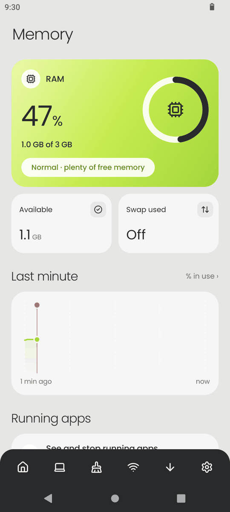

- The **green card** shows how much RAM is in use and a verdict ("Normal · plenty of free memory").
- **Available** and **Swap used** are the figures behind it; **Last minute** is a live chart.
- **Running apps** lists the apps in memory with their size and state (In use, Visible, Running, Recent, Cached). **Stop** force-stops one app; **Free memory** closes all background apps.

The running-apps list needs [privileged access](#18-privileged-access-shizuku-helper-root): Android doesn't show other apps' memory to normal apps. Without it, **Boost** closes background apps on Android 13 and older; Android 14 and newer don't allow even that.

## 10. Battery

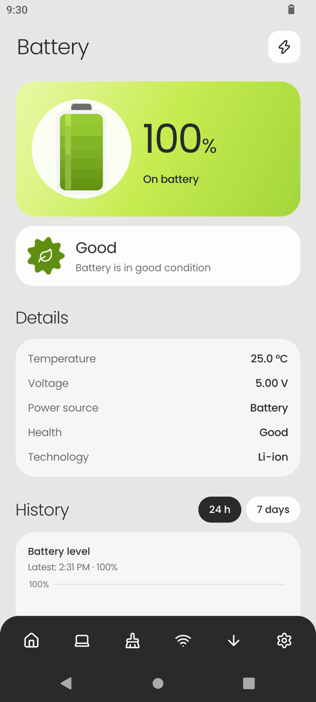

| Part | What it shows or does |
|---|---|
| **Green card** | Charge level and whether the phone is charging (with time to full on Android 9+). |
| **Condition** | Android's own verdict on the battery ("Good"). |
| **Details** | Temperature, voltage, power source, health, technology, charge cycles (Android 14+). |
| **Battery Saver** switch | Turns Android's Battery Saver on or off. If the app isn't allowed to change it, the Battery saver screen opens and says what is missing. |
| **Battery saver tools** | Opens the Battery saver screen. |
| **Freezer** | Opens the Freezer. |
| **History** | Charts of level and temperature over **24 h** or **7 days**, average drain per hour, when the phone was last full, and an estimate of the time left. The app samples about every 15 minutes, so the charts fill up over time. |
| **App battery use** | Android's estimate per app since the last full charge. Needs privileged access. |

## 11. Battery saver

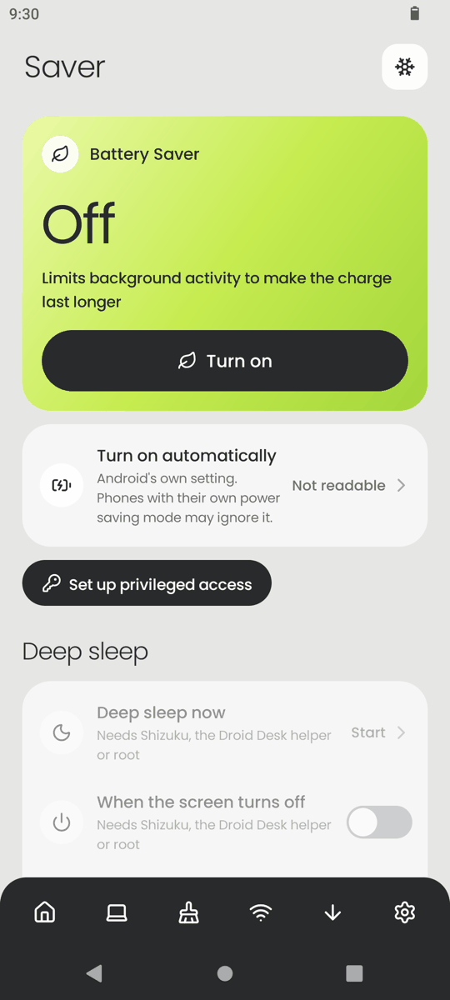

Each part says what it needs and is greyed out with the reason while that is missing.

| Part | What it does | Needs |
|---|---|---|
| **Battery Saver** (Turn on / Turn off) | Android's own Battery Saver: limits background activity. | Privileged access, or a permission Andromon grants over USB |
| **Turn on automatically** | Battery Saver switches on by itself below the level you choose. | The same |
| **Deep sleep now** | Puts the phone into Android's deep idle mode at once. Ends when the screen turns on. | Privileged access |
| **When the screen turns off** | Deep sleep every time the screen goes off (not while charging). | Privileged access |
| **Charging** | Charging current and power, a reminder at a charge level you choose (70–95%), a fully-charged alert and an overheating alert. | Notifications |
| **Awake now** | Apps that keep the phone awake, with **Stop**. | Privileged access |
| **App limits** | Per app: how much Android lets it run in the background (Active, Rare, Restricted) and a background restriction. | Privileged access |

**Set up privileged access** opens the right part of Settings.

Good to know: Android turns Battery Saver off while charging. Phones with their own power saving mode (Samsung and others) may ignore the switch; the screen says so. In deep sleep, notifications and syncing are delayed; calls, SMS and alarms still arrive.

## 12. Freezer

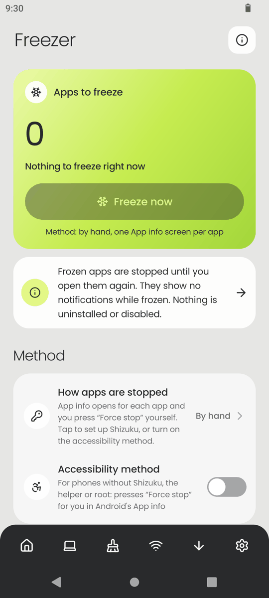

Stops apps that run in the background without being used. "Freezing" is the same as **Force stop** in Android's App info: the app stays stopped until you open it again. Nothing is uninstalled, and a frozen app shows no notifications.

| Part | What it does |
|---|---|
| **Apps to freeze** | How many apps are waiting to be frozen right now. **Freeze now** stops them. |
| **How apps are stopped** | The method in use: **privileged access** (silent, no screens), the **accessibility method**, or **by hand** (App info opens for each app and you press Force stop). |
| **Accessibility method** | For phones without privileged access: the app presses "Force stop" for you in App info. You also have to switch the service on in Android's Accessibility settings. |
| **App list** | Every app with a line saying why it will or won't be frozen. Tap an app to choose its mode. |
| **Automatic** | Freeze **when the screen turns off** (at once or after a delay) and **when the battery drops below** a level. Both need privileged access to act silently. |
| **Shortcuts** | Add a **Freeze now** shortcut to the home screen or a quick-settings tile. |

**Modes per app**

| Mode | Meaning |
|---|---|
| **Always** | Frozen every time, whenever it is running. |
| **When unused** | Frozen only if you haven't used it for a while (7 days by default). Needs usage access. This is the default for apps you installed. |
| **Never** | Left alone. System apps, the keyboard, the phone and SMS apps start here. |

Apps you are using right now (on screen, playing music, navigating) are skipped. Freezing an app you open many times a day costs more battery than it saves.

## 13. Apps

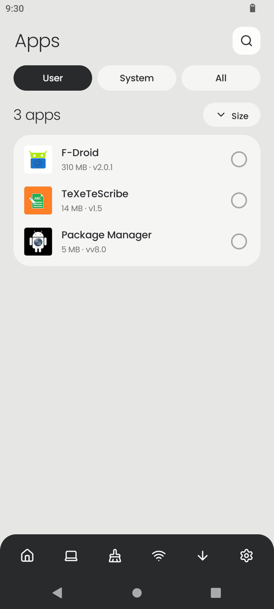

- **User / System / All** chooses the list; the magnifier searches; the **Size** button changes the order (size, name, install date, last update, screen time, least recently used).
- Tap an app for its details: version, install and update dates, where it was installed from, app/data/cache size, screen time and last use.
- Actions per app: **Open**, **App info**, **Play Store**, **Export APK** (to `Download/Andromon/APKs`) and **Uninstall**.
- Tick the circles to uninstall several apps in a row. Android asks for each one.

Sizes and usage figures need usage access (Andromon allows it at install).

## 14. Storage

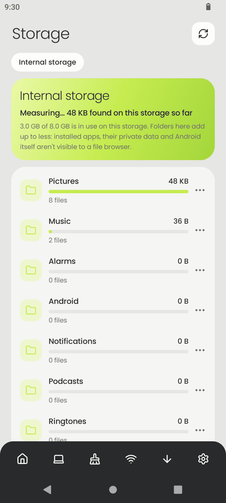

A folder browser that shows what takes up space.

- Folders and files are listed **largest first**, each with a bar for its share.
- Tap a folder to go in; Back goes up. Tap a file to open it.
- The **three dots** delete a file or folder after a confirmation that names its path and size. Deleted items don't go to a recycle bin.
- With an SD card, a chip at the top switches between the storages.

Installed apps and Android itself aren't visible to a file browser, so the folders add up to less than "used".

## 15. Permissions

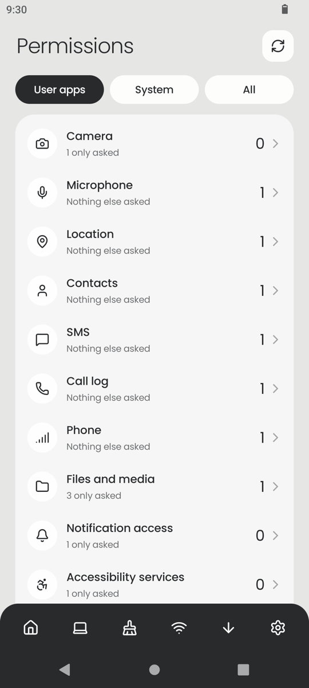

Shows which apps may use sensitive things.

- One row per group: Camera, Microphone, Location, Contacts, SMS, Call log, Phone, Files and media, Notification access, Accessibility services, Device admin, Display over other apps, Install unknown apps, All files access.
- The number is how many apps are **allowed**; the line below says how many only **asked**.
- **User apps / System / All** chooses which apps are counted.
- Tap a group to see its apps. Tap an app to open Android's App info, where you can take the permission away.
- With privileged access, the list also shows **when each app last used** the camera, microphone, location, contacts, SMS and call log.

## 16. Hardware test

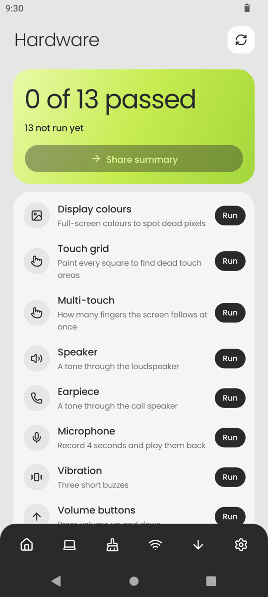

A checklist of 13 guided checks. Tap **Run** on a row.

| Check | How it works |
|---|---|
| Display colours | Full-screen white, black, red, green and blue to spot dead pixels. |
| Touch grid | Paint every square to find dead touch areas. |
| Multi-touch | Counts how many fingers the screen follows. |
| Speaker, Earpiece | Play a tone; you say whether you heard it. |
| Microphone | Records 4 seconds and plays them back. Nothing is saved. |
| Vibration, Volume buttons, Flashlight | Try each and confirm. |
| Sensors | Live values of the motion, light, proximity and other sensors. |
| Cameras, Wi‑Fi / Bluetooth / GPS / NFC, Fingerprint | Lists what the phone reports having. |

Where the phone can tell the result, it fills it in; otherwise you tap **Passed** or **Failed**. **Share summary** sends the results as text.

## 17. Settings

| Appearance, PC link, Tools | Access, Privileged access |
|---|---|
| 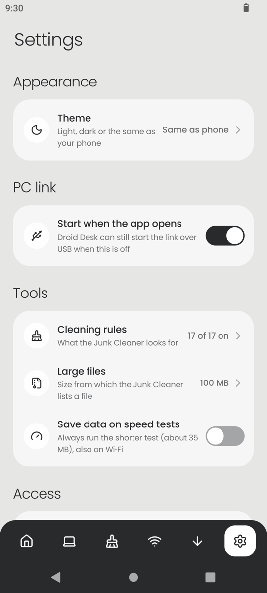 | 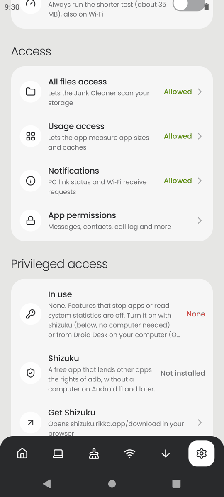 |

| Section | Option | What it does |
|---|---|---|
| **Appearance** | Theme | Light, dark, or the same as the phone. |
| **PC link** | Start when the app opens | On: opening the app also starts the link to Andromon. Andromon can always start the link over USB, even when this is off. |
| | Clear link history | Removes the PC link screen's recent activity, the PC link figures in Stats and the names of the computers that connected. |
| **Tools** | Cleaning rules | Which of the Cleaner's rules run (17 in all). |
| | Large files | The size from which the Cleaner lists a file as large (50 MB to 1 GB). |
| | Save data on speed tests | Always runs the shorter speed test, also on Wi‑Fi. |
| **Access** | All files access, Usage access, Notifications, App permissions | The state of each access the app uses. Tap one to open its Android setting. Stats needs Usage access. |
| **Privileged access** | In use, Shizuku, Get Shizuku, Prefer, Finish setup | See the next section. |
| **About** | Privacy, Licence, Third-party notices | What the app does with data, and the licences. |

## 18. Privileged access (Shizuku, helper, root)

Some features need more rights than Android gives a normal app: the Memory screen's running apps, the Freezer's silent freezing, Deep sleep, app limits, per-app battery use and last-use times in Permissions. The app can borrow these rights in three ways:

| Way | How to turn it on | Lasts |
|---|---|---|
| **Shizuku** | Install the free [Shizuku](https://shizuku.rikka.app) app and start it (its own guide explains how; Andromon's **Shizuku** page also has **Start Shizuku**). Then tap **Grant permission** in the companion's Settings. No computer is needed afterwards. | Until the phone restarts (always on rooted phones) |
| **Andromon helper** | In Andromon on the computer: **Shizuku › Phone RAM manager**. | Until the phone restarts |
| **Root** | On rooted phones: **Memory › Use root instead**. | Until the phone restarts |

Under **Settings › Privileged access**:

- **In use** shows which way is active right now, or "None", and why, in full.
- **Shizuku** shows its state: not installed, not running, waiting for permission, or ready.
- **Prefer** chooses between Automatic (Shizuku first), Shizuku, or the helper/root.
- **Finish setup without a computer** lets the app grant itself, through Shizuku, the permissions Andromon would normally grant over USB.

Whichever way is used, the app can only run a fixed list of commands (list processes, stop an app, read battery statistics and so on). It can't touch other apps' private data.

## 19. Notification buttons and quick-settings tiles

- **"Connected to Andromon" notification:** **Stop** ends the link; **Send clipboard to PC** copies the phone's clipboard to the computer.
- **"From your computer" notification:** appears when you send a link or text from Andromon. Tapping it opens the link or copies the text.
- **Find my phone:** when started from Andromon, the phone rings at full volume and shows **Found it**.
- **Receive notification:** shows progress and **Accept / Decline** for incoming transfers.
- **Quick-settings tiles** (add them by editing the quick-settings panel): **PC link**, **Receive files**, **Send clipboard to PC** and **Freeze now**.

## 20. Privacy

- Messages, contacts, the call log, calendar and notifications go **only to Andromon** on computers you connected or paired, through the adb link.
- The app uses the network only for the Network screen's tests and for Wi‑Fi receive and send while you have them on.
- There are no accounts, no ads and no analytics. The app is free software (GPL-3.0); the licences are under **Settings › About**.

## 21. Stats

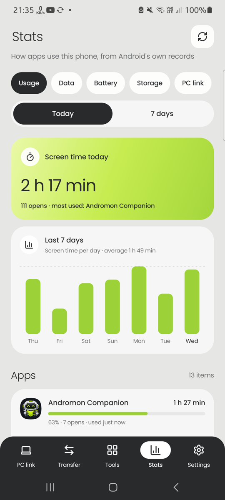

How apps use the phone, from Android's own records. The chips at the top choose the kind; **Today / 7 days** chooses the time where it applies. Each kind has a green card with the total, a bar chart and a list of apps with their share; tap an app for its details (the same as in Apps).

| Kind | What it shows | Good to know |
|---|---|---|
| **Usage** | Screen time and how often each app was opened, when it was last used, and screen time per day for the last 7 days. | An app counts while it is on screen; the home screen and the system bars don't count. Needs usage access. |
| **Data** | Mobile data and Wi‑Fi per app, and per day for the last 7 days. | As Android counts it, in 2-hour blocks: "Today" can include a little of late yesterday. Apps you uninstalled are grouped as "Removed apps". Needs usage access. |
| **Battery** | Each app's use since the last full charge, in mAh, as Android estimates it. | Android only shares this with privileged access (Settings › Privileged access); without it the screen says so and offers the setup. |
| **Storage** | App, data and cache size of every app, the biggest first. | Needs usage access. Caches can be cleared from Andromon on the computer (Apps › Clear app caches). |
| **PC link** | Sessions, time linked, requests by kind, files and bytes sent and received over Wi‑Fi, clipboard shares and the computers that connected. | Kept on the phone for 30 days. |

When usage access is off, Stats says so and offers **Allow usage access**.
